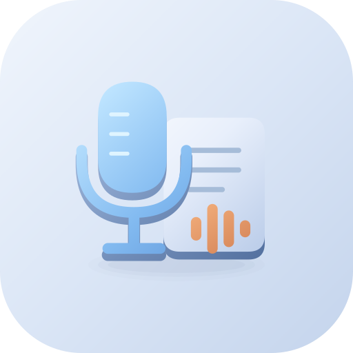

# Offline Speech to Text | گفتار به متن آفلاین

[Download / دریافت برنامه](https://github.com/cinaasadpour-hash/offline-speech-to-text/releases/latest)

## فارسی

گفتار به متن آفلاین، صدای ضبط‌شده یا فایل صوتی را با مدل Whisper روی خود گوشی به متن تبدیل می‌کند. پس از دریافت یک مدل، برای تبدیل گفتار به اتصال اینترنت نیاز ندارید و صدا برای پردازش به سرور ارسال نمی‌شود.

امکانات:
• ضبط صدا و تبدیل فایل‌های صوتی سازگار، مانند WAV، MP3 و M4A
• انتخاب زبان گفتار فارسی، انگلیسی یا تشخیص خودکار
• سه مدل Tiny، Base و Small با تفاوت در حجم، سرعت و دقت
• کپی، اشتراک‌گذاری و ذخیره متن خروجی
• رابط فارسی و انگلیسی و پوسته روشن، تیره یا مطابق گوشی
• بررسی سلامت فایل مدل پس از دریافت

نیازمندی‌ها: اندروید ۱۰ یا بالاتر و پردازنده ۶۴بیتی ARM. مدل‌ها جدا از برنامه و با اینترنت دریافت می‌شوند و تقریباً ۷۸، ۱۴۸ یا ۴۸۸ مگابایت فضا می‌گیرند. مدت هر ضبط یا فایل ورودی حداکثر ۵ دقیقه است. سرعت و دقت به مدل، قدرت گوشی، زبان و کیفیت صدا بستگی دارند. متن خروجی را پیش از استفاده بازبینی کنید.

این نسخه تبلیغات و پرداخت درون‌برنامه‌ای ندارد.

## English

Offline Speech to Text transcribes recordings and supported audio files directly on your phone with Whisper. Download a model once, then transcribe without an internet connection. Audio is not uploaded to a transcription server.

Features:
• Record speech or import compatible WAV, MP3 and M4A audio
• Persian, English or automatic speech-language detection
• Tiny, Base and Small models with different speed, storage and accuracy trade-offs
• Copy, share and save transcript text
• English and Persian interfaces with light, dark and device-based themes
• Model-file integrity checks

Requires Android 10 or later and a 64-bit ARM processor. Models are downloaded separately using the internet and take approximately 78, 148 or 488 MB. Each recording or imported file can be up to 5 minutes. Speed and recognition accuracy depend on the model, phone, language and audio quality. Review generated text before using it.

This version has no advertising or in-app purchases.

## Getting started | شروع کار

Open Models and download one model. Tiny uses the least memory. Set Speech language separately from App language in Settings, then record or choose audio from Transcribe. Copy, share or export the result. Download models before going offline.

از بخش مدل‌ها یک مدل دریافت کنید؛ Tiny حافظه کمتری مصرف می‌کند. زبان گفتار را جدا از زبان برنامه در تنظیمات انتخاب کنید. سپس در بخش تبدیل، صدا ضبط یا فایل انتخاب کنید. نتیجه را می‌توانید کپی، ذخیره یا اشتراک‌گذاری کنید.

Package: `com.sinatools.offlinespeechtotext` · Version: **1.0.0** · Target SDK: **36**.

[Privacy / حریم خصوصی](PRIVACY.md)

This repository distributes the signed APK and user-facing artwork and guides. Private recordings, models, backups, source and signing credentials are not uploaded.
