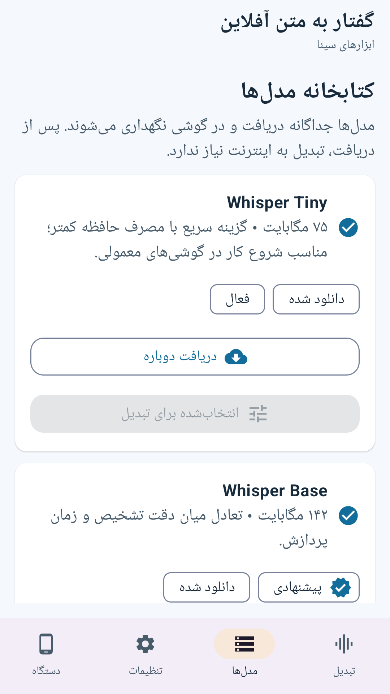
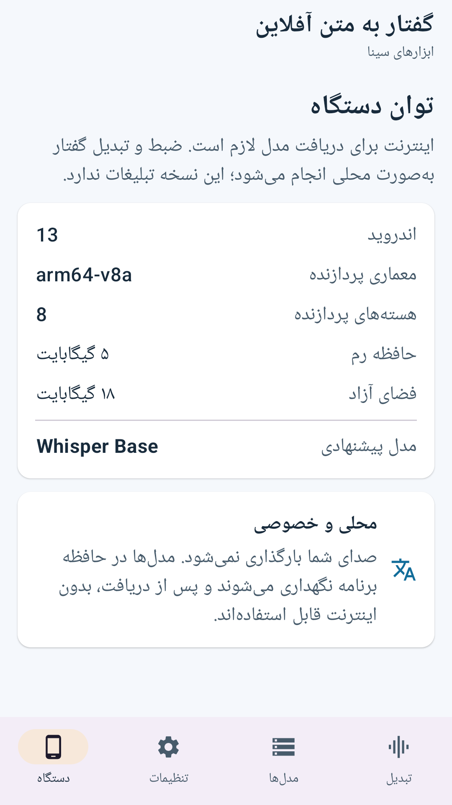
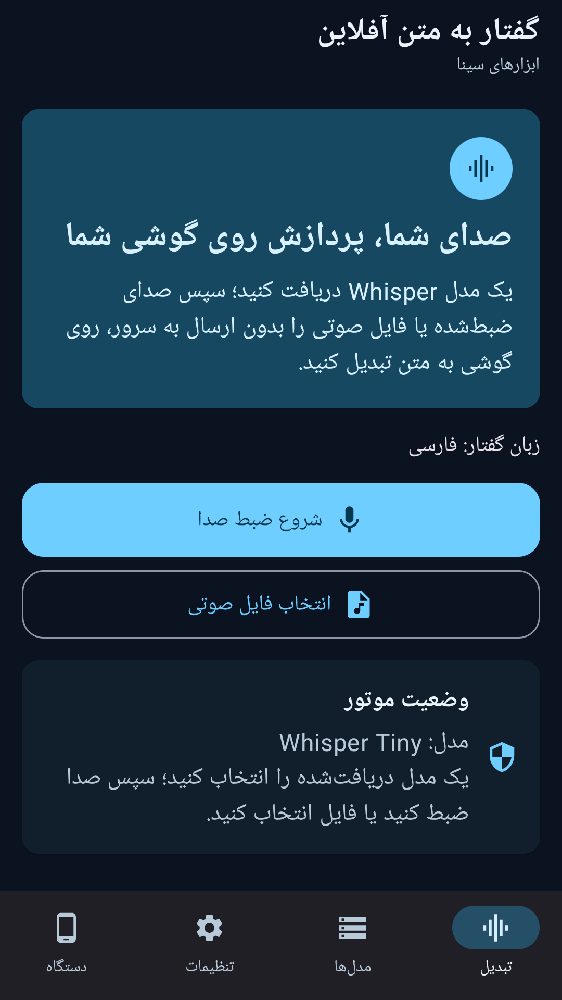
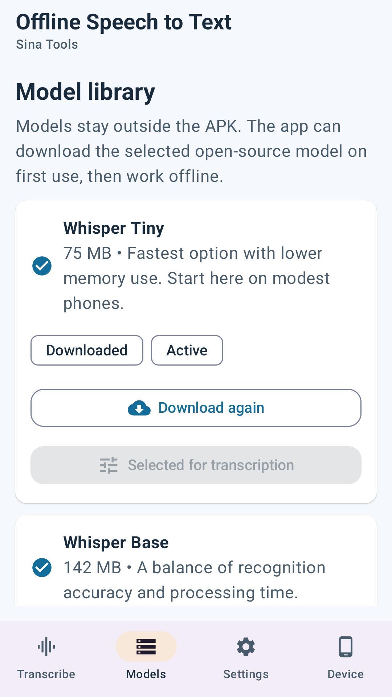
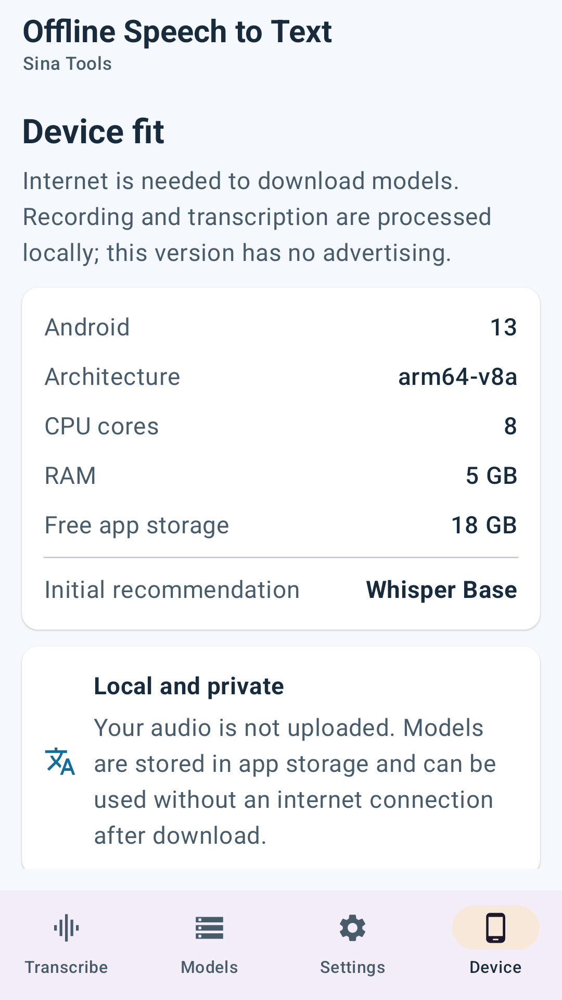
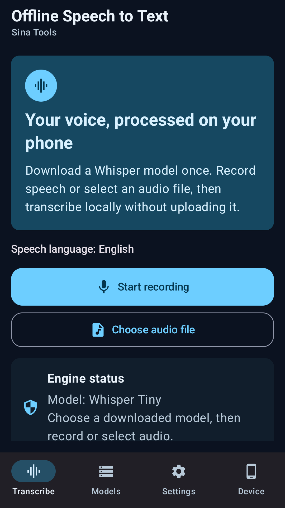

# Offline Speech to Text | گفتار به متن آفلاین

[Download / دریافت APK](https://github.com/cinaasadpour-hash/offline-speech-to-text/releases/tag/v1.0.1)

Package: `com.sinatools.offlinespeechtotext` · Version: **1.0.1** · Version code: **3**

## فارسی

تبدیل ضبط و فایل صوتی به متن روی گوشی با مدل Whisper.

گفتار به متن آفلاین، ضبط و فایل صوتی را با استفاده از مدل Whisper روی دستگاه به متن تبدیل می‌کند. ابتدا از بخش مدل‌ها یک مدل دریافت کنید، زبان گفتار را انتخاب کنید و سپس صدا ضبط کنید یا فایل صوتی وارد کنید. متن خروجی را می‌توانید بازبینی و ذخیره یا اشتراک‌گذاری کنید.

پس از دریافت مدل، تبدیل صدا به ارسال فایل به سرور نیاز ندارد. دریافت اولیهٔ مدل به اینترنت نیاز دارد. هر ضبط یا فایل ورودی حداکثر پنج دقیقه است.

رابط فارسی و انگلیسی و حالت روشن و تاریک در دسترس است. اندروید ۱۰ به بالا و پردازندهٔ ARM با معماری ۶۴بیتی لازم است. سرعت و دقت به مدل، قدرت دستگاه، زبان و کیفیت صدا بستگی دارد؛ متن تولیدشده را پیش از استفاده بررسی کنید.

## English

Transcribe recordings and audio files locally with Whisper models.

Offline Speech to Text converts recordings and audio files into text on your device using Whisper. Download a model from Models, choose the speech language, then record audio or import a file. Review the transcript and save or share it when you choose.

After a model is downloaded, transcription does not require uploading audio to a server. The initial model download requires internet access. Each recording or imported file is limited to five minutes.

Persian and English interfaces and light and dark themes are available. Requires Android 10 or later and a 64-bit ARM processor. Speed and accuracy depend on the model, device, language and audio quality. Review generated text before relying on it.

## Privacy / حریم خصوصی

See [Privacy / حریم خصوصی](PRIVACY.md). Store listing text in both languages is available in [store-listing](store-listing).

## Verification / بررسی

The signed APK was installed and launched on a Samsung Galaxy A32 with Android 13 on 2026-10-30, with existing app data preserved. The installed APK checksum matched the release file. Production Tapsell identifiers and the release certificate were checked in the APK. Detailed visual and functional coverage varies by app; this is not a guarantee of compatibility with every device or external service.

نسخهٔ امضاشده در ۳۰ اکتبر ۲۰۲۶ روی گوشی نصب و اجرا شد و اطلاعات قبلی حفظ شد. اثرانگشت نسخهٔ نصب‌شده با فایل انتشار برابر بود. نام بسته، امضا و شناسه‌های واقعی تپسل در APK بررسی شدند. محدودهٔ آزمون هر برنامه متفاوت است و سازگاری با همهٔ دستگاه‌ها و خدمات تضمین نمی‌شود.

A public audio sample was transcribed locally in the recorded functional tests. Persian recognition accuracy was not benchmarked. / تبدیل واقعی نمونهٔ صوت عمومی قبلاً آزمایش شده؛ دقت تشخیص فارسی معیارسنجی نشده است.

Speech engine: [whisper.cpp](https://github.com/ggml-org/whisper.cpp). Models are downloaded separately.

## تصاویر برنامه

## Screenshots

